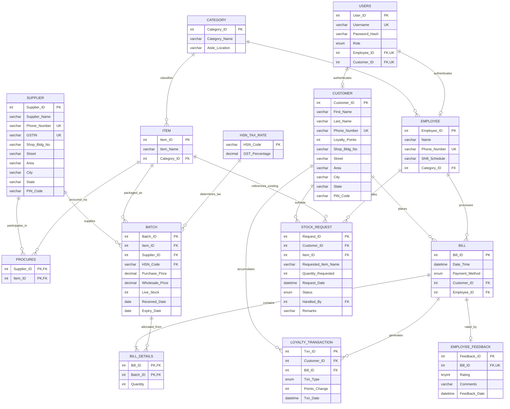

# Entity-Relationship (ER) Diagram & Relational Schema
## Supermarket Management System | Group 23 | B.Tech CSE, IIT BHU
### Target Database: MySQL 8.0.16+ (`supermarket_db`)

---

## 1. Visual Entity-Relationship Diagram (Mermaid)

The following diagram visualizes all 14 entities, their primary keys, foreign keys, and relationship cardinalities as implemented in `db/01_schema.sql`.

---

## 2. Relational Schema Mapping & Cardinalities

| Relationship | Cardinality | Explanation |
| :--- | :---: | :--- |
| **Category → Item** | 1 : N | Each category holds multiple items; an item belongs to at most one category. |
| **Category → Employee** | 1 : N | An employee manages inventory in one category floor/aisle. |
| **Supplier ↔ Item (`Procures`)** | M : N | A supplier can supply multiple items, and an item can be procured from multiple suppliers. Modeled via the `Procures` junction table. |
| **Item → Batch** | 1 : N | An item can have multiple historical delivery batches with differing prices and expiry dates. |
| **Supplier → Batch** | 1 : N | A batch is purchased from a specific supplier. |
| **HSN_Tax_Rate → Batch** | 1 : N | Each batch is tied to statutory HSN tax codes. Insert-only preservation ensures historical accuracy. |
| **Bill ↔ Batch (`Bill_Details`)** | M : N | A bill contains multiple batches (items); a batch can be sold across multiple bills. Modeled via `Bill_Details`. |
| **Customer → Bill** | 1 : N | A registered customer has multiple purchase bills. Walk-in customers have `Customer_ID = NULL`. |
| **Employee → Bill** | 1 : N | Each bill is processed by one cashier employee. |
| **Bill → Employee_Feedback** | 1 : 1 (Optional) | At most one service rating can be submitted per bill. |
| **Customer → Loyalty_Transaction** | 1 : N | Every point addition (earned) or reduction (redeemed) creates an immutable audit row. |
| **Users ↔ Employee / Customer** | 1 : 1 (Specialized) | Role-Based Access Control table. Enforced by SQL `CHECK` constraint: Owner has neither link; Employee links only to `Employee_ID`; Customer links only to `Customer_ID`. |

---

## 3. Normalization Defense (1NF to BCNF)

### First Normal Form (1NF)
* All attributes are atomic (no multi-valued lists or arrays stored in columns).
* Addresses are decomposed into atomic attributes: `Shop_Bldg_No`, `Street`, `Area`, `City`, `State`, and `PIN_Code`.
* Every table has a primary key (`AUTO_INCREMENT` or compound PK).

### Second Normal Form (2NF)
* The schema is in 1NF.
* All non-key attributes are fully functionally dependent on the entire primary key:
  * In compound tables like `Bill_Details(Bill_ID, Batch_ID)`, `Quantity` depends on both the Bill and the Batch.
  * In `Procures(Supplier_ID, Item_ID)`, there are no partial dependencies.

### Third Normal Form (3NF) & No Transitive Dependencies
* **No Stored Totals on Bill:** Totals, GST, and discounts are **never** stored on the `Bill` table. Storing them would cause a transitive dependency (`Bill_ID → Batch_ID → Wholesale_Price → Total`). Instead, totals are dynamically computed in `v_bill_lines` and `v_bill_totals`.
* **Separation of Tax Rates:** `HSN_Tax_Rate(HSN_Code, GST_Percentage)` is separated from `Item` and `Batch`. The tax rate depends strictly on the government `HSN_Code`, eliminating transitive tax anomalies.
* **Separation of Batch vs Item:** Prices (`Wholesale_Price`, `Purchase_Price`) and stock (`Live_Stock`, `Expiry_Date`) live in `Batch`, not `Item`, because wholesale prices fluctuate between supplier shipments.

### Boyce-Codd Normal Form (BCNF)
* For every non-trivial functional dependency $X \rightarrow Y$, $X$ is a superkey.
* Unique constraints (`Phone_Number`, `GSTIN`, `Username`) act as candidate keys and enforce strict determinism.

---

## 4. Key Viva Questions & Explanations

1. **Why does `Bill` not have an `Amount` or `Total` column?**
   * *Answer:* To satisfy 3NF and prevent data redundancy/inconsistency anomalies. If a batch price or line quantity were corrected, a stored total would drift out of sync. Dynamic aggregation via the view `v_bill_totals` guarantees mathematical consistency.
2. **Why does `Batch` have both `Wholesale_Price` and `Purchase_Price`?**
   * *Answer:* `Purchase_Price` is what the supermarket paid the supplier (cost), and `Wholesale_Price` is what is charged to the customer (revenue ex-GST). This enables accurate calculation of gross profit and profit margins in the view `v_profit_per_item`.
3. **How is concurrent billing protected against race conditions?**
   * *Answer:* When `sp_create_bill` runs, it executes `SELECT Batch_ID, Live_Stock FROM Batch ... FOR UPDATE`. This applies row-level write locks in MySQL InnoDB. If two cashiers bill the last remaining unit at the exact same millisecond, the second transaction is blocked until the first commits, whereupon it detects insufficient stock and rolls back.
4. **Why are HSN Tax Rates insert-only?**
   * *Answer:* Government GST rates can change across fiscal years. If we updated an existing HSN row, past bills printed 6 months ago would recalculate to the new rate, violating statutory tax audit laws. A new rate is given a new entry, leaving historical batch rates intact.

